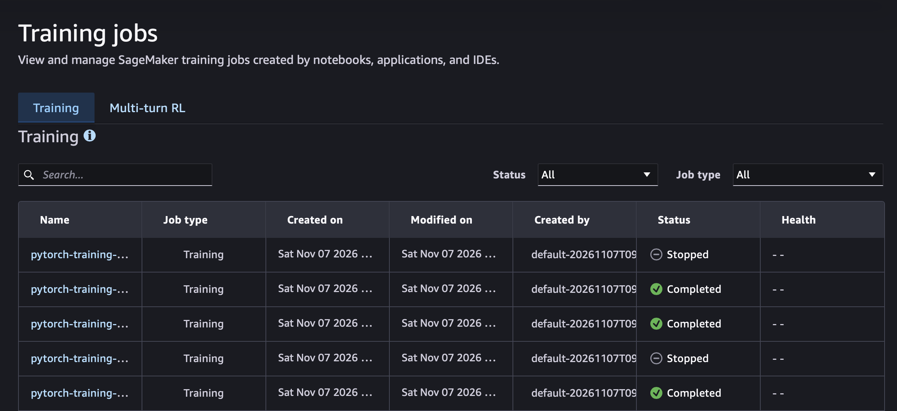
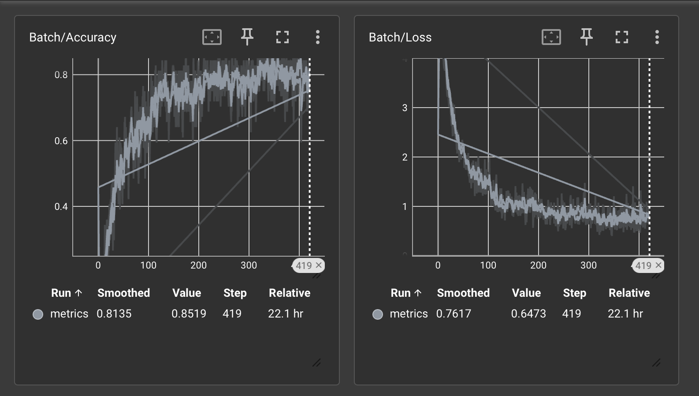
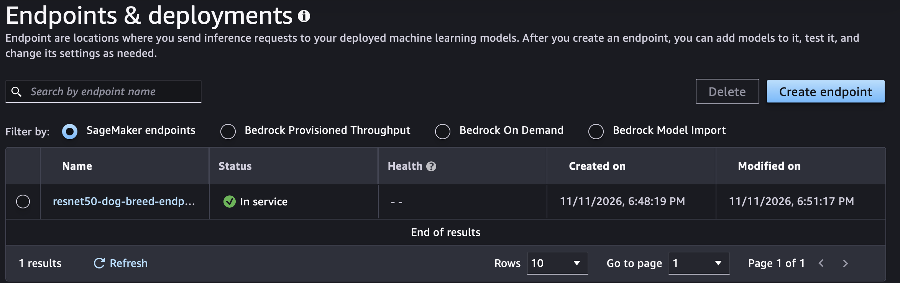

# Udacity Machine Learning - AWS SageMaker - Fine-tuning ResNet50 to classify dog breeds

This is solution of project #3 in Udacity Machine Learning program.

The goal of this project is to build Image Classification model.
It aims to assign breed of the dog on provided image.
The model is fine-tuned on *Dog Breed Dataset*.

## Try it yourself

### Requirements

- Git
- AWS Cloud

1. Execute Jupyter notebook [train_and_deploy.ipynb](./train_and_deploy.ipynb) in SageMaker Studio.


## Project structure

```text
udacity-machine-learning-image-classification-with-aws-sagemaker/
├── hpo.py                 # Hyperparameter optimization script
├── train_model.py         # Model training script
├── train_and_deploy.html  # Project workspace as HTML file
├── train_and_deploy.ipynb # Project workspace as Jupyter notebook
└── README.md              # README file
```

## Hyperparameter Optimization

In order to solve main problem ResNet50 architecture was selected.
Hyperparameter optimization was performed to find the best parameters.
Below table shows loss values for all tested hyperparameter combinations:

| Batch Size | Epochs | Learning Rate             | Optimizer | Loss value             |
| ---------- | ------ | ------------------------- | --------- | ---------------------- |
|     **64** |  **4** | **0.0038940075053948960** |  **Adam** | **0.4791969954967499** |
|         64 |      4 |     0.0046897104564080050 |      Adam |     0.6021945476531982 |
|         64 |      1 |     0.0037338008076578787 |   RMSprop |     0.7474458813667297 |
|        256 |      3 |     0.0015819044035065258 |   RMSprop |     1.6783027648925781 |
|         64 |      3 |     0.0097900668677548120 |       SGD |     2.8632850646972656 |

### SageMaker Training Jobs Dashboard



## Debugging

While training model, few scalar metrics were captured. 
Below charts contain loss and accuracy values for validation datasets after steps:



## Inference

Executing `train_and_deploy.ipynb` will allow to create SageMaker endpoint and perform inference on provided images.



In order to get response from that endpoint we need to use following code:

```python
import json

with open("your_image.jpg", "rb") as f:
    image_bytes = f.read()

response = endpoint.invoke(
    body=image_bytes,
    content_type="application/x-image",
)

result = json.loads(response.body.read().decode("utf-8"))
result
```
